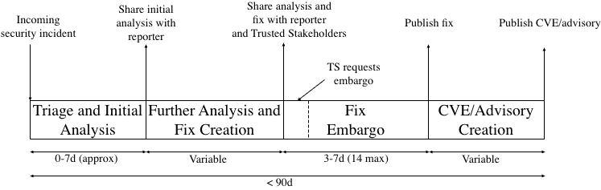

Security Incident Handling Process
==================================

Reporting
---------

If you think you have found a security vulnerability in Trusted Firmware
**infrastructure** (e.g. the website), then please follow the
`Linaro security policy <https://www.linaro.org/vdp>`__ and ignore the rest of
this process.

If you think you have found a security vulnerability in Trusted Firmware
projects then please send an email to one or more of the relevant project
specific security team aliases :doc:`here <mailing_aliases>`. These are private
teams of security officers who will help verify the security vulnerability,
develop and release a fix, and disclose the vulnerability details responsibly.
The security teams are referred to from now on as "us/we/our". We do our best
to respond and fix any issues as soon as possible.

IP security issues are out of scope of this process. Depending on the type of
IP, please contact Arm PSIRT, your Arm account manager or the IP vendor's PSIRT
(for non-Arm IP) to report such issues.

Only security issues affecting platform-independent code are in scope. If the
security issue entirely lies in platform-specific code or code that is only used
by a single platform, we recommend to report it to the relevant platform owners
and their Product Security Incident Response Teams (PSIRT) directly. If we
receive such reports, we reserve the right to forward them ourselves.

As with any bug, the more information you provide, the easier it is to diagnose
and fix. We encourage you to provide a fix and to include the relevant code
owners in the report, as that can speed up the process considerably. Any
exploit code is very helpful. We may bring in extra help to understand and
fix the vulnerability.

Please let us know your disclosure plans if you have any. This may affect our
disclosure plan as described in the next section.

Please indicate any sensitive information you do not wish us to share. We
reserve the right to share any information you provide with trusted third
parties and eventually the public unless you request otherwise.

You may use :download:`this PGP/GPG key <pub_security_at_trustedfirmware_subkeys_3.asc>`
for encrypting the vulnerability information. This key is also available at
https://keyserver.pgp.com and LDAP port 389 of the same server. The
fingerprint for this key is:

54F8 6138 58DB 00F2 2EE7 D559 EB2C 1B71 C010 2B2B

If you would like replies to be encrypted, please provide your public key.
Please note we cannot guarantee that encrypted information will remain
encrypted when shared with trusted third parties.

If we consider the bug not to be a security vulnerability, we will inform you
and direct the bug to the normal bug fixing process.

Disclosure
----------
Our default security vulnerability disclosure plan is shown in the figure below:

   Trusted Firmware security incident handling process

The detailed steps are as follows. This may change if disclosure needs to be
coordinated with the reporter or other stakeholders.

1. For confirmed security vulnerabilities, we will develop a robust fix as soon
   as possible. During this time, we will only share information with the
   reporter and those needed to develop the fix.

   The fix will include backports to active Long Term Stable (LTS) branches,
   though delivery of some backports may be deferred until they are required
   to avoid delaying disclosure and deployment of the fix.

   Security fixes will contain the minimum information required to fix the
   bug. Any additional vulnerability details will be published later, in step
   4 below.

2. After a robust fix becomes available, our preference is to publicly release
   it as soon as possible. We will automatically do this if the vulnerability
   is already publicly known. Otherwise, we will share the fix and relevant
   vulnerability information with
   :ref:`registered Trusted Stakeholders (TS) <ts_registration_label>`. We may
   batch multiple vulnerabilities into a single notification.

   We may embargo the fix if a TS requests it within 3 working days of being
   notified (Monday to Friday, in their time zone), and we agree the
   criticality of the vulnerability requires more time for fix deployment. The
   requested embargo period should be as short as possible, up to 7 calendar
   days after the TS receives the fix, with an exceptional extension to 14
   days. The only valid reason for requesting an embargo is to enable the TS
   to deploy the fix. If the fix requires further refinement during the embargo
   period, then the fix embargo period will restart.

   Due to export control restrictions, some Trusted Firmware projects may not
   be allowed to distribute the fix privately. For such projects, there is no
   fix embargo period, but we will notify TS of the vulnerability ahead of
   public release, to enable them to prepare for fix deployment.

3. We will release the fix publicly to mainline and affected LTS branches.

4. After fix is released, we will publish a corresponding CVE. Some projects
   may also publish a security advisory. We may choose to batch these
   CVE/advisory publications, for example on a fixed schedule or at release
   time.

   We aim to complete this process as soon as possible and no later than 90
   days after the vulnerability was first reported.

.. _embargoed_info_label:

Handling embargoed (non-public) information
-------------------------------------------
On receipt of embargoed information, you must not disclose any of the provided
information beyond the group of people in your organization that need to know
about it. During any fix embargo period, that group of people should be limited
to those entrusted to assess the impact of the vulnerability on your
organization and deploy fixes to your products. After the the fix is public,
that group of people may be expanded in order to prepare your organization's
public response. Embargoed information must not be shared outside your
organization under any circumstances.

If you think another individual/organization requires access to embargoed
information, then please ask them to :ref:`register <ts_registration_label>`
as a TS. If you believe there has been a leak of embargoed information then
please notify us immediately.

We welcome feedback on embargoed information at any time.

.. _ts_registration_label:

Trusted Stakeholder registration
--------------------------------
The security team of each Trusted Firmware project maintains a private, vetted
list of organizations and individuals who are considered Trusted Stakeholders
(TS) of security vulnerabilities for that project. TS are organizations
impacted by security vulnerabilities found in a Trusted Firmware project and
thus need to be informed before public disclosure.

If you want to register as a TS, and the project support's the TS process,
please contact the relevant project security team alias(es) as listed
:doc:`here <mailing_aliases>`, providing the following information:

1. Which Trusted Firmware project(s) you want to register for.

2. A justification of why you should be on the list. That is, why you should
   know about security vulnerabilities and have access to security fixes before
   they are made public. For example, a valid reason is that your organization
   has deployed products using Trusted Firmware that may need to be patched.

3. Your full name and a valid email address. This should be an organization
   email address where possible. We prefer individuals in each organization to
   coordinate their registration requests with each other and to provide us
   with an email alias managed by your organization instead of us managing a
   long list of individual addresses.

4. Confirmation that you and the individuals in your organization will handle 
   embargoed information responsibly as described in the
   :ref:`embargoed_info_label` section.

Note, we reserve the right to deny registration or revoke membership to the
TS lists, for example if we have concerns about the confidentiality
of embargoed information.
